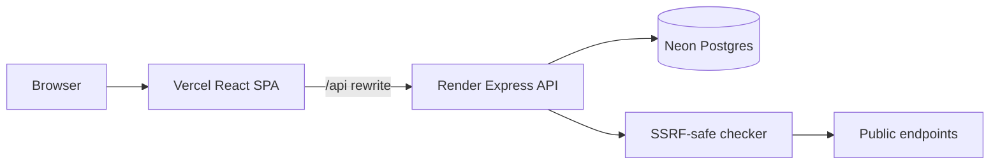

# Watcher

> Your APIs. Always in Sight.

Watcher is an API uptime and latency monitor.

## What it does

- Registers and authenticates users with short-lived access tokens and rotating refresh cookies.
- Creates private HTTP(S) monitors and runs scheduled or manual checks.
- Stores recent check history and shows uptime, latency, and status.
- Blocks private and reserved destinations with DNS and connect-time SSRF protection.

## Tech stack

React, Vite, Tailwind, TanStack Query, Axios, Express, PostgreSQL, TypeScript, undici, Zod, Pino.

## Architecture



## Local setup

Prerequisites: Node.js 20, Docker Desktop.

```powershell
docker compose up -d db
Copy-Item backend\.env.example backend\.env
Copy-Item frontend\.env.example frontend\.env
cd backend
npm install
npm run migrate
npm run dev
```

In another terminal:

```powershell
cd frontend
npm install
npm run dev
```

Open `http://localhost:5173`.

## Security

- Access tokens stay in memory; refresh tokens are httpOnly cookies.
- Refresh-token families rotate and revoke on reuse.
- Every monitor and result query is scoped to the authenticated owner.
- URLs are checked at creation and again at connection time to defeat DNS rebinding.
- API routes use validation, Helmet, CORS allowlisting, body limits, and rate limits.

## Known limitations

- Render free-tier sleeping pauses the in-process scheduler.
- Rate limiting is in-memory and resets on restart.
- V1 uses one Node.js process for API, scheduler, and checking.
- No alerting, status pages, custom headers, or request bodies.

## Roadmap

- V2: Redis and Kafka.
- V3: alerts and analytics.
